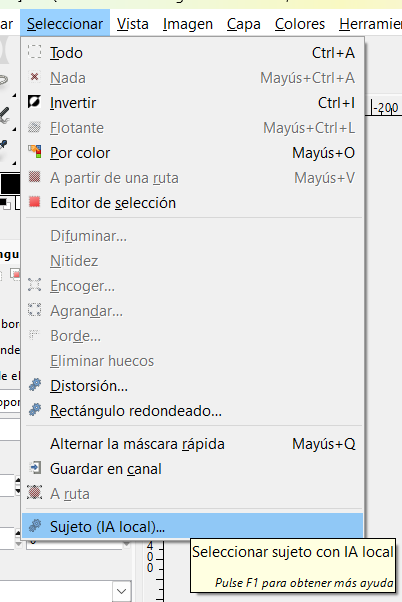
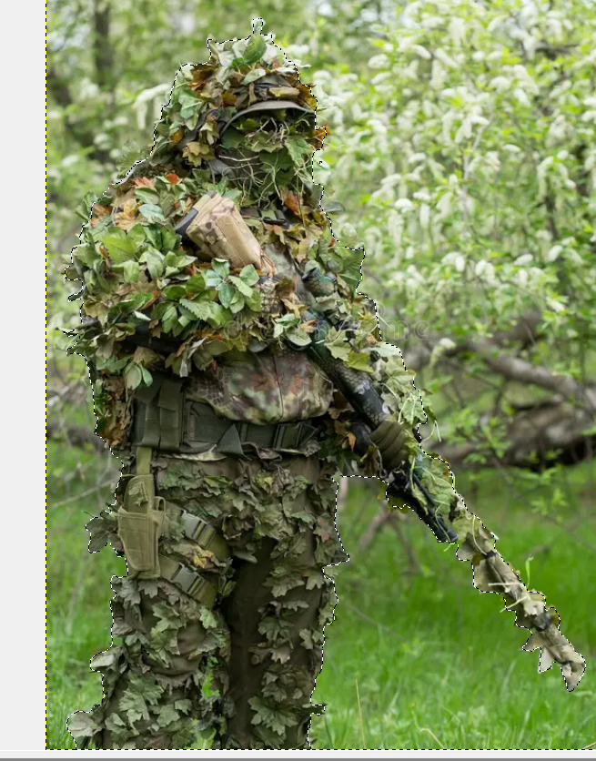
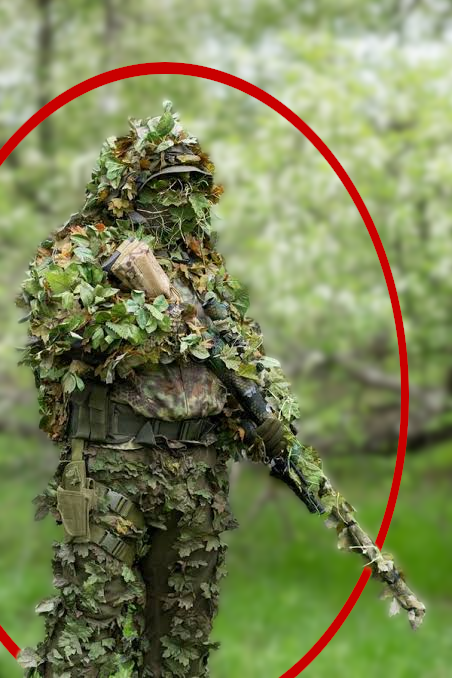

<div align="center">

[](#)
[](#)
[](#)

---

<table align="center" width="100%">
  <tbody>
    <tr align="center">
      <td>
        
      </td>
      <td>
        
      </td>
      <td>
        
      </td>
  </tbody>
</table>
</div>

# Smart Subject — selección de sujeto con IA local para GIMP

Módulo instalado y probado en **GIMP 2.10.38, Windows x64**. Incluye el modelo,
Python 3 y todas las dependencias; no requiere Python global, CUDA ni Conda.
La inferencia trabaja sin conexión y sin telemetría.

## Uso

1. Abrir o reiniciar GIMP y seleccionar una capa de píxeles RGB o gris.
2. Usar **Seleccionar → Sujeto (IA local)…** para crear una selección suave.
3. Usar **Capa → Máscara → Máscara de Sujeto (IA)…** para generar la máscara.
   También está registrado en **clic derecho sobre la capa → Máscara**.

“Añadir máscara de capa” es un comando que abre un diálogo de GIMP, no un
submenú extensible. Por eso la acción IA se integra en el menú Máscara estándar.
El plugin muestra progreso nativo mientras el motor procesa la imagen.

La selección reemplaza la selección actual y conserva los píxeles y la capa
activa. La máscara conserva la selección actual. Si ya existe una máscara, se
combina por multiplicación con la nueva y se activa. Las modificaciones se
agrupan en una operación de deshacer. Se respetan dimensiones, offsets positivos
y negativos y píxeles totalmente transparentes. No se procesa la composición de
todas las capas, los grupos ni las imágenes indexadas.

## Trasladar a tu carpeta de GIMP

Copiar **la carpeta completa `smart-subject`** al directorio `plug-ins` del otro
perfil de GIMP 2.10 para Windows x64. Mantener su nombre y el del archivo
`smart-subject.py`. Reiniciar GIMP. No hay rutas absolutas en la configuración de
ejecución ni dependencias del perfil original.

También se puede ejecutar desde PowerShell:

```powershell
.\install.ps1 -GimpProfile 'D:\GIMP-portable\Data\GIMP\2.10'
```

El instalador copia el módulo y verifica el modelo; rechaza sobrescribir una
instalación existente. El ZIP portable contiene la misma carpeta preparada para
extraer directamente en `plug-ins`.

## Diagnóstico y configuración

Ejecutar `doctor.cmd`, o:

```powershell
.\runtime\python.exe .\backend\engine.py --doctor
.\runtime\python.exe .\backend\engine.py --in 'foto.png' --out 'mascara.png'
```

El diagnóstico verifica SHA-256 y carga la sesión ONNX con el límite de memoria.
`config.json` permite ajustar hilos, tiempo máximo y límite de píxeles. El máximo
de memoria permitido es 2048 MiB. La configuración entregada usa cuatro hilos y
un timeout de 180 segundos. En Windows se aplica una cuota de memoria comprometida
del proceso mediante Job Object; ONNX usa CPU y desactiva su arena persistente.
Las imágenes excepcionalmente grandes pueden exceder la cuota y generar un error
controlado. No se garantiza procesar imágenes arbitrariamente grandes bajo 2 GB.

Los temporales se crean en un directorio exclusivo por operación y se borran al
terminar, incluso ante fallos ordinarios o timeout. Una terminación forzada de
GIMP o del sistema puede dejar un directorio `gimp-smart-subject-*` en el temporal
del sistema. La ejecución normal no necesita ni utiliza acceso de red.

## Modelo y rendimiento comprobado

Se utiliza [BiRefNet Lite 512 de Studio Ludens](https://huggingface.co/studioludens/birefnet-lite-512),
derivado de [BiRefNet de ZhengPeng](https://github.com/ZhengPeng7/BiRefNet).
Su licencia MIT se incluye en `models/LICENSE-BiRefNet.txt` y la documentación
original en `models/MODEL-CARD.md`.

El manifiesto fija la revisión upstream y su SHA-256. La preparación reemplaza
20 convoluciones deformables expandidas por `DeformConv` nativa, mueve constantes
a inicializadores y resuelve optimizaciones estáticas con ONNX Runtime. Los pesos
entrenados se conservan. Esto evita el pico de memoria de la exportación original.
El archivo final pesa **90.482.370 bytes**, frente a 98.484.532 del original.
El módulo completo, con el runtime, ocupa más de 100 MB: ese límite se cumple para
el modelo, no para la distribución autónoma entera.

Mediciones locales con AMD Ryzen 7 7730U, cuatro hilos, foto de 612×408:

| Prueba | Tiempo |
|---|---:|
| Comando de selección desde GIMP | 5,066 s |
| Comando de máscara desde GIMP | 4,497 s |
| Motor independiente, incluida carga | 2,787 s |

Pico de memoria residente del motor: aproximadamente **590 MB**. Los tiempos
dependen del equipo, resolución y almacenamiento; no son una garantía universal
de menos de diez segundos. Informes reproducibles en `tests/*.json`.

La inferencia usa RGB normalizado con ImageNet, entrada 512×512, sigmoid sobre
logits y ampliación bilineal al tamaño original. Mantiene cobertura parcial, sin
umbral binario. Se compensa la conversión gamma de PixelRgn de GIMP 2 para que una
cobertura del 50 % siga siendo del 50 %. BiRefNet Lite produce una máscara suave
de sujeto; no garantiza reconstrucción física perfecta de cabello o cristal. La
entrada 512 prioriza memoria y velocidad y limita el detalle fino en fotos grandes.

## Estructura y desarrollo

```text
smart-subject/
  smart-subject.py          registro gimpfu, Python 2.7
  client_gimp2.py           exportación, IPC, selección y máscara
  backend/engine.py        fachada CLI y adaptador ONNX, Python 3
  models/                  modelo, manifiesto y licencia
  runtime/                 Python 3.12.10 embebido + dependencias
  config.json              rutas relativas y recursos
  setup.ps1                diagnóstico o reconstrucción
  install.ps1              copia a otro perfil
  doctor.cmd               verificación local
  tools/                   descarga, preparación y empaquetado
  tests/                   pruebas reales de backend y GIMP
```

No hace falta ejecutar `setup.ps1` para usar o trasladar esta entrega. Sobre una
copia íntegra, `setup.ps1` verifica todo sin descargas. Para reconstruir desde
código sin runtime o pesos, requiere conexión y un Python 3.12 x64 de desarrollo
con pip:

```powershell
.\setup.ps1 -BuildPython 'C:\Python312\python.exe'
```

Solo durante reconstrucción se descargan Python.org, paquetes PyPI y los pesos
de Hugging Face. ONNX es una herramienta de desarrollo, no una dependencia del
motor. Las versiones de ejecución están fijadas en `requirements-lock.txt`.
Los avisos de módulos Python antiguos ajenos a este proyecto no impiden las
pruebas del módulo nuevo.

Para repetir pruebas:

```powershell
.\runtime\python.exe .\tests\download_fixtures.py
.\runtime\python.exe .\tests\make_fixtures.py
.\runtime\python.exe .\tests\backend_checks.py
.\runtime\python.exe .\tests\run_gimp.py integration_gimp2.py
.\runtime\python.exe .\tests\run_gimp.py e2e_gimp2.py
```

El ejecutable de GIMP es el segundo argumento opcional de `run_gimp.py`. Las
pruebas usan imágenes propias de prueba; no abren documentos del usuario.

La arquitectura desacopla el cliente gimpfu del backend mediante archivos PNG y
CLI, y permite un futuro cliente GI para GIMP 3. **El cliente de GIMP 3 no está
implementado**: copiar esta entrega a un perfil 3.x no lo convierte en compatible.
El runtime entregado funciona en Windows x64. Linux/macOS requieren distribuir un
runtime para su plataforma y validar las APIs de GIMP allí; esa distribución no
se ha probado ni se presenta como terminada.

Licencia del código: MIT. Los componentes de terceros conservan sus licencias
dentro de `runtime` y `models`.
